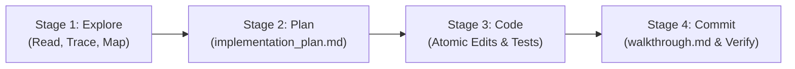

# Claude Code Setup: Disciplined 4-Stage Engineering Loop

*(Reverse-engineered from anthropics/claude-plugins-official/plugins/claude-code-setup)*

This skill mandates the disciplined execution loop used by premier software engineering agents: **Explore ➔ Plan ➔ Code ➔ Commit**. Never jump straight into code modifications without exploratory validation and architectural consensus.

## The 4-Stage Execution Loop

### 1. Stage 1: Explore (Zero Mutations)
- Investigate the codebase without mutating any source files.
- Inspect directory trees, dependencies in `package.json` / `pyproject.toml` / `requirements.txt`.
- Trace imports, configurations, environment variables, and existing patterns.
- Read only relevant lines or sections; never dump massive files.

### 2. Stage 2: Plan (Architectural Consensus)
- Generate a comprehensive `implementation_plan.md` artifact before making edits.
- The plan must define:
  1. User request summary and requirements.
  2. Proposed changes broken down into atomic steps.
  3. Affected files and newly introduced components.
  4. Testing and verification strategy (unit, integration, visual).
- Stop and request explicit user review or feedback before coding when required.

### 3. Stage 3: Code (Atomic, Safe Implementations)
- Follow the plan step-by-step.
- Make targeted edits (`replace_file_content` or exact contiguous edits) rather than rewriting entire files blindly.
- Verify syntax, lint rules, and type signatures immediately after each edit.
- Run local unit tests or build commands inside the sandbox to catch regressions early.

### 4. Stage 4: Commit & Document (Walkthrough)
- Inspect `git status` and `git diff` to confirm only expected files were modified.
- Generate a `walkthrough.md` artifact showing:
  - What was created or modified.
  - Verification results (test outputs, build status).
  - Screenshots / visual checks where applicable.
- Update project memory files in `.brain/` (`STATUS.md`, `HANDOFF.md`).

## Project `/init` Protocol
When initializing an empty or newly created workspace:
1. Initialize git repository if not already present.
2. Initialize `.brain/` persistent memory structure (`MAP.md`, `STATUS.md`, `HANDOFF.md`, `DECISIONS.md`).
3. Scaffold `DESIGN.md` via `awesome-design-md`.
4. Install and configure required base dependencies and linting rules.

