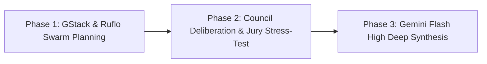

# Swarm Council: Multi-Role Deliberation & Swarm Planning

*(Synthesized from garrytan/gstack, ruvnet/ruflo, and hex/claude-council for Gemini 3.7 / 3.8 Flash High)*

This skill orchestrates a multi-perspective deliberation board and execution pipeline before writing complex code, ensuring thorough trade-off analysis, edge-case mitigation, and high-confidence architecture.

## The 3-Phase Swarm Pipeline

### Phase 1: GStack & Ruflo Swarm Decomposition
- **Task Graph Generation**: Ruflo breaks down incoming requirements into an acyclic task graph (DAG).
- **Virtual Team Role Allocation (GStack)**:
  - **CEO / Product Strategist**: Focuses on user value proposition, 10x differentiation, and business viability.
  - **Principal Architect**: Focuses on microservices, schema design, latency, and system modularity.
  - **Security Lead**: Enforces zero-trust backend authentication, secret isolation, and data governance.
  - **UI/UX Lead**: Enforces the anti-slop design system, responsive layouts, and the 34 Production Pages checklist.
  - **QA / Resilience Lead**: Anticipates network drops, edge cases, race conditions, and error recovery.

### Phase 2: Claude Council Deliberation & Jury Defense
The virtual council convenes to deliberate on conflicting technical trade-offs. It runs the **5 Tough Jury Questions**:
1. *Scalability*: How will this architecture behave under a 100x traffic spike or 10M rows?
2. *Security*: Where is the exact boundary where an unauthenticated client could attempt unauthorized state change?
3. *Failure Recovery*: If a downstream API or database connection times out, what does the user experience?
4. *Maintenance Cost*: How difficult will it be for an engineer unfamiliar with the project to modify this 6 months from now?
5. *Edge Cases*: What happens on network disconnects, concurrent writes, or invalid unicode inputs?

### Phase 3: Gemini Flash High Deep Synthesis
Gemini 3.7 / 3.8 Flash High synthesizes all council deliberations, resolves trade-offs decisively, and produces:
- The definitive **System Architecture & ER Diagram**.
- Concrete `implementation_plan.md` artifact with clear, step-by-step verification milestones.
- Initialized `DESIGN.md` via `awesome-design-md`.

